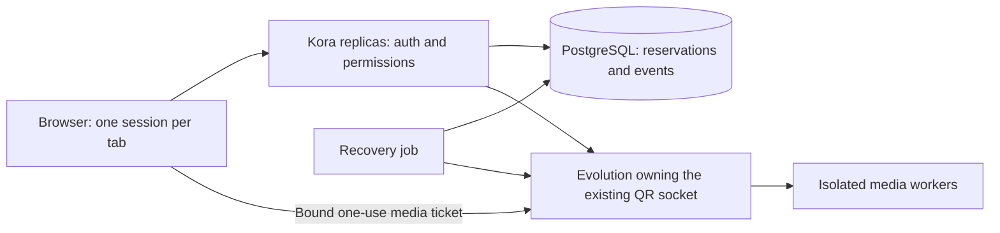

# Voice control plane and growth

Decision record, 2026-10-14. Implementation and rollout status must be distinguished from the target architecture.

## Invariants

1. One nonterminal call attempt per WhatsApp line, across Kora replicas.
2. One nonterminal call attempt per human operator, across tabs, lines and tenant memberships.
3. A reservation belongs to a tenant, registered line, conversation, authenticated operator, browser session and attempt. Browser-supplied destinations, tenant IDs and backend addresses never choose the line.
4. Reservation precedes media ticket issuance. A competing operator cannot replace a preparing operator's ticket.
5. Media and control belong to the same reservation. Knowing a WhatsApp call ID does not authorize a hangup.
6. Every reservation has a monotonically increasing fence. A late command or cleanup cannot affect its successor.
7. Expiration means recovery is needed. An unreachable engine does not prove the line is free.
8. Starting a call is not automatically retried after an ambiguous network response. Reconcile the same attempt first.
9. Restarting Kora does not erase ownership. Restarting Evolution changes its boot identity and invalidates its old media tickets.
10. Only an explicit backend observation or pre-dial cancellation finalizes a reservation. Unknown outcomes remain identifiable in reports.

## Boundaries

PostgreSQL serializes ownership and persists attempts. It never transports audio. Redis can later carry worker inventory, job delivery and fast occupancy notifications; it must not become an independent, contradictory source of call ownership. Keep durable ownership and business quotas in one transactional authority.

Evolution remains the exclusive owner of each Baileys session. Its local reservation guard fences the media connection and native call. A local guard alone cannot enforce an operator limit across several Evolution hosts; the database reservation provides that guarantee.

## Identity and admission

The browser creates a per-tab session ID and a per-attempt random ownership capability. Only its hash is stored. Kora derives tenant, user, conversation and instance from its authenticated context. It checks account entitlement, active membership, visibility, participation and per-line agent grants before reserving.

The database takes ordered transaction advisory locks for the line and operator. Partial unique indexes provide a second integrity barrier. A repeated attempt with the same owner is idempotent. A different attempt loses admission with LINE_BUSY or OPERATOR_BUSY. Preparation has both a renewable lease and an absolute deadline so an indefinitely open microphone prompt cannot occupy a line forever.

Admission also locks the physical backend origin/instance fingerprint: duplicate Kora rows must not independently reserve the same native line. Cancellation of an absent attempt persists a capability-bound tombstone so a delayed claim cannot appear after the browser was told it was cancelled. Do not purge these tombstones while old attempt IDs remain admissible. A future retention policy must first bound attempt reuse; the pilot retains them and rate-limits creation.

Kora then sends the verified owner, fence and deadline to the existing instance's authenticated Evolution API. The media ticket records this owner and the current backend boot identity. Dial, status renewal, cancellation and hangup verify ownership again. Raw capabilities and authenticated webhook paths must not appear in URLs, logs or event payloads.

## Lifecycle and recovery

States: preparing → dialing → ringing → connected → ending → ended. Cancellation, failure, interruption and unknown are explicit terminal outcomes; recovering retains occupancy until reconciled. Late ringing/connected observations cannot revive an ending or terminal attempt.

If an operator disappears during preparation, stop its media setup and release only after the matching backend confirms no dial is pending and no call remains. If a call is active, request its end and retain ownership until native idle/end. A disconnected backend keeps the reservation recovering, independently of other lines. Recovery uses bounded batches and leases so multiple job runners cannot process the same claim concurrently.

Event keys deduplicate retransmissions. The first delivery stage records server observations and control decisions; these are not exact native CDR timestamps. A subsequent Evolution outbox will provide durable native events. Billing and recording must not treat polling observations as precise connected durations.

## Capacity and placement

Business entitlement, call occupancy and physical engine capacity are separate decisions. A connected QR does not imply free engine capacity.

Today each enabled line eagerly starts a media process, including while idle. The current two-line pilot is not an unlimited customer pool. The next capacity stage must allocate engines on demand after reservation, bound warm idle lifetime and enforce measured memory/CPU/bandwidth limits. Idle lines should retain their messaging socket without consuming a full native media engine.

Introduce a backend registry with origin, instance placement, boot identity, supported protocol version, readiness and advertised engine capacity. Admission reserves worker capacity before audio opens. Full capacity returns a clear unavailable/busy result or an explicit bounded queue; silently oversubscribing is forbidden.

Horizontal growth adds Evolution shards. Route each line to the shard that owns its QR socket and auth store. Do not put indistinguishable Evolution replicas with the same sessions behind round-robin routing. Media workers are presently local IPC children; moving them to another host requires an authenticated signaling bridge and a separate engineering milestone.

## Provisioning

Target: God Mode grants the account; the owner grants agents/numbers; a provisioner reconciles eligible lines with the backend registry and capacity pool. Enabling a customer should not require an Evolution restart or a hand-edited ENV allowlist. The existing two-line allowlist remains the pilot mechanism until this provisioner and on-demand lifecycle are implemented.

## Delivery sequence and acceptance

1. Durable line/operator reservation, fenced backend ownership and browser integration, gated per pilot line. Verify concurrent claims from independent Kora replicas, cross-tenant rejection, same-user competing tabs, ticket preparation races, wrong-owner control and late cleanup.
2. Recovery runner and durable native outbox. Verify crashes at every boundary: before backend admission, after ticket, while dialing, after native acceptance and before persistence. Exercise ambiguous HTTP responses without redial.
3. On-demand engine admission and provisioning without restarting messaging. Measure warm/idle/active memory, CPU and bandwidth before selecting limits.
4. Two real lines, then bounded simultaneous load. Verify messages and calls on both; backend isolation and operator fairness; lost network and QR replacement; capacity rejection; recovery and rollback.
5. Additional shards and operational quotas. Recording, inbound calls, transfers and queuing follow explicit product policies and separate proof.

New database objects must be mapped against the current production schema, indices, triggers, RLS, grants and function signatures before application. Additive migration, service-only RPCs, feature flags off by default, migration before code activation, Evolution guard before Kora pilot activation. Never activate only half of the ownership protocol. Production remains on the already validated two-line configuration until the new release is reviewed and its gates pass.

## Implementation status and switches

The first milestone is implemented on the ownership branches: DB admission, per-boot native fencing, bound tickets/control, browser reservation before media and an authenticated bounded recovery route. It is not activated in production. The native outbox, on-demand pool, automated provisioning and multi-shard registry remain planned work.

- Kora: `VOICE_RESERVATIONS_ENABLED=true` plus `VOICE_RESERVATIONS_INSTANCE_IDS`.
- Evolution: `VOICE_RESERVATIONS_REQUIRED=true` plus `VOICE_RESERVATIONS_INSTANCE_NAMES`.
- Recovery: `VOICE_RESERVATIONS_RECOVERY_ENABLED=true` plus `VOICE_RESERVATIONS_RECOVERY_INSTANCE_IDS`; it requires a scheduler calling `/api/cron/voice-reconcile` with the existing cron credential. Default batch size is four and processing concurrency is two.
- Preparation deadline: 120 seconds; owner lease: 90 seconds. Only the owning browser renews it. The background conversation observer cannot keep it alive. The native sweep checks expired leases every five seconds. Clock synchronization and heartbeat delivery must be monitored; an expired live owner has its audio closed and call terminated rather than transferred to another browser.
- Native and Kora HTTP/DB work has bounded timeouts. Ambiguous failures retain occupancy for reconciliation; they never trigger an automatic new dial.

See [the current production preflight](voice-ownership-production-map.md) and migration for the release gates. Source references: [PostgreSQL explicit locks](https://www.postgresql.org/docs/17/explicit-locking.html), [PostgREST select casting](https://docs.postgrest.org/en/stable/references/api/tables_views.html), [Supabase read-only Management API queries](https://supabase.com/docs/reference/api/v1-run-a-query).
